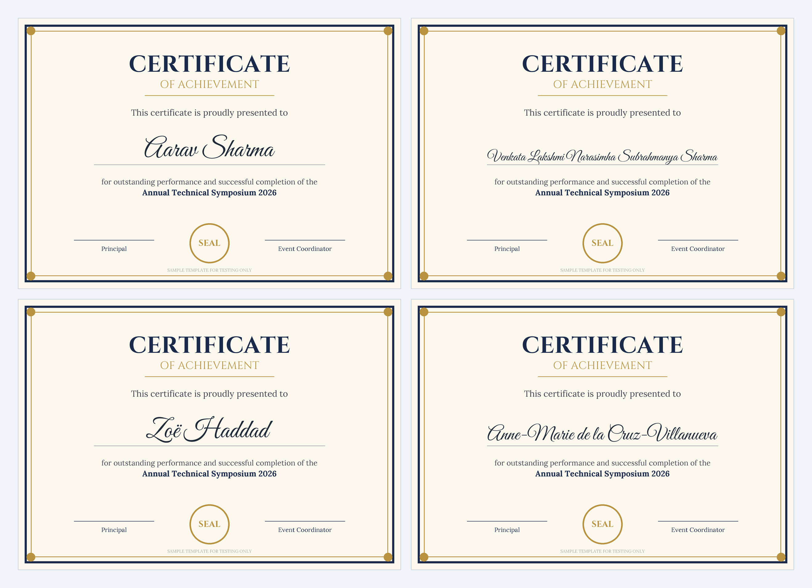
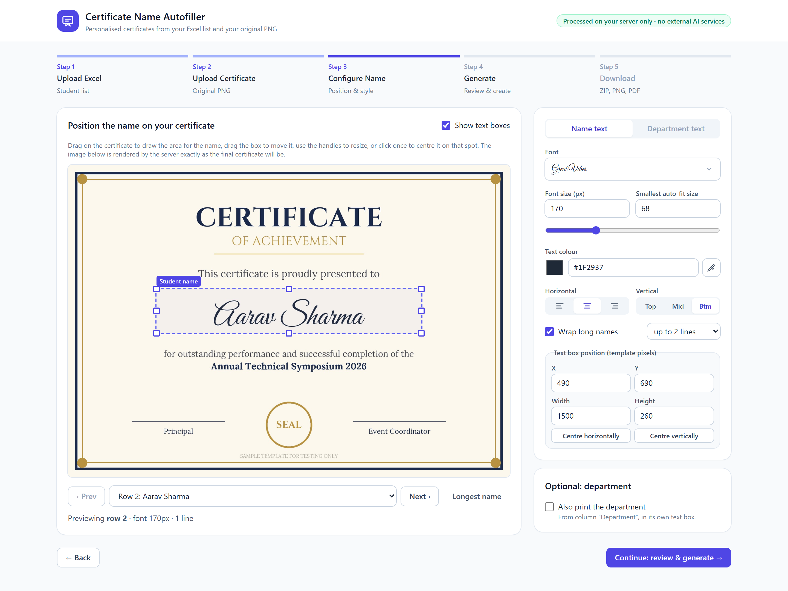
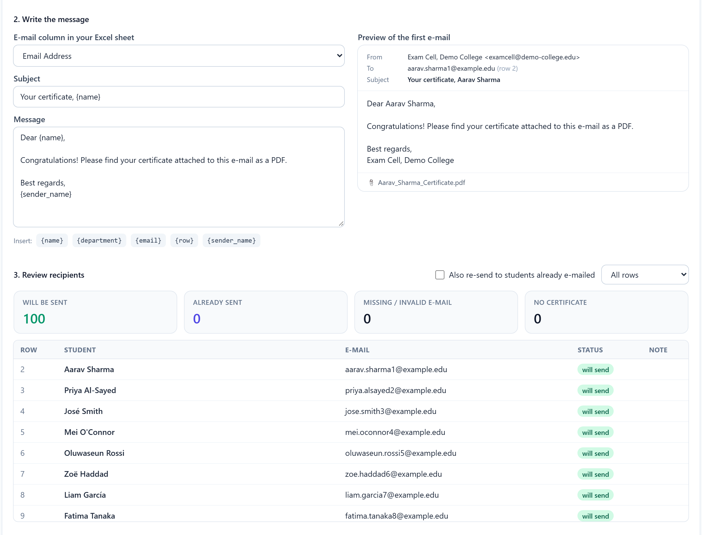

# Certificate Name Autofiller

Generate one personalized certificate per student from an **Excel sheet** and **your original PNG certificate**.

The uploaded PNG is used unchanged as the background of every certificate. The app does not redesign or regenerate it, and it uses no AI image generation. Only the student's name (and, if you turn it on, the department) is drawn on top. Outputs keep the template's exact pixel dimensions, DPI and colour profile, and are saved losslessly as PNG, with optional lossless PDF.

```
Excel upload → PNG upload → column mapping → name placement → live preview → approval → bulk generation → ZIP download
```



| Live name editor | E-mail delivery |
|---|---|
|  |  |

More screenshots are in [`docs/screenshots`](docs/screenshots). All names and addresses shown are fictional sample data.

---

## Contents

1. [Features](#features)
2. [Project structure](#project-structure)
3. [Install and run](#install-and-run)
4. [How to use](#how-to-use)
5. [Tests](#tests)
6. [Configuration](#configuration-env)
7. [API reference](#api-reference)
8. [Privacy and security](#privacy-and-security)
9. [Complex scripts (Tamil, Hindi, Arabic and others)](#complex-scripts-tamil-hindi-arabic-and-others)
10. [Known limitations](#known-limitations)

---

## Features

**Excel (.xlsx / .xls)**
- Detects the header row automatically, even below title rows. Recognises headers such as *Student Name*, *Name of the Student*, *Dept.*, *E-mail ID*.
- If detection fails, you map the columns manually. You can also pick the sheet and the header row, including "no header row".
- Preserves the original spelling and capitalization. Only stray, duplicate or invisible whitespace is cleaned. A literal `NA` stays a name.
- Flags blank names, duplicate names and invalid emails, each with its Excel row number. Completely empty rows are ignored.
- Each record keeps its original Excel row number, so certificates map 1:1 to rows and are reported in row order.

**Editor**
- Drag on the certificate to draw the name area, drag the box to move it, use the handles to resize, or click once to centre it on a spot. Exact X/Y/width/height inputs are also available.
- Font, size, colour (with an eyedropper to sample colours from the certificate in Chromium browsers), horizontal and vertical alignment.
- Fonts:
  - 13 bundled open-source fonts (script, serif, sans). Variable fonts also offer Medium, SemiBold and Bold.
  - Common system fonts if installed, e.g. Times New Roman, Monotype Corsiva, Edwardian Script.
  - **Upload your own `.ttf`/`.otf`** to match the certificate exactly.
- **Auto-fit:** a long name is first reduced in size, down to "Smallest auto-fit size". If it still doesn't fit, it is wrapped onto 2–4 balanced lines. Anything that still doesn't fit is reported, never silently clipped.
- **The preview is rendered by the backend with the same code as the final output**, so what you see is exactly what you get. Previews are downscaled only for display.
- Optional department text in its own box and style.

**Generation and download**
- Runs in a background job with a progress bar and a cancel button. Rendering is parallel; 100 certificates at 2480×1754 take about 4–11 s.
- Every row ends with an explicit status: `generated`, `skipped` (blank name) or `failed` (with a reason).
- File names look like `Student_Name_Certificate.png`, with case-insensitive collision handling (`_2`, `_3`) and safe characters only.
- Downloads: individual PNG/PDF files, a ZIP of everything (`pdf/` folder included when PDFs are enabled), and `generation_report.csv`.

**E-mail delivery (optional)**
- Sends each student **their own certificate as a PDF** to the e-mail address(es) in their Excel row, from your own account over SMTP.
- Presets for Gmail / Google Workspace, Microsoft 365, Outlook.com and Yahoo, plus any custom SMTP server (college/company relay).
- The login is verified before anything can be sent.
- An editable subject and message with `{name}`, `{department}`, `{email}`, `{row}` and `{sender_name}` placeholders, and a live preview of the real first e-mail.
- Before sending:
  - a recipient review that flags missing or invalid addresses, rows without a certificate, and addresses shared by several rows
  - a **test e-mail to yourself**
  - an authorisation tick-box and **typing the exact number of e-mails**
- While sending:
  - messages go out one at a time over a single connection, throttled
  - live progress and a per-student status; you can stop at any time
  - sending stops automatically on login, quota or rate-limit errors
- After sending:
  - "Retry unsent" for anything that failed
  - a downloadable `email_report_*.csv`
  - students already e-mailed are never e-mailed again unless you tick "re-send"

---

## Project structure

```
certification model/
├── start.bat / start.ps1      one-click launcher for Windows
├── backend/
│   ├── app/
│   │   ├── main.py            FastAPI app and all /api routes
│   │   ├── config.py          settings from environment / .env
│   │   ├── models.py          request schemas (Pydantic)
│   │   ├── excel_parser.py    reading, header detection, cleaning, analysis
│   │   ├── renderer.py        text layout (fit/shrink/wrap) and drawing with Pillow, PNG/PDF output
│   │   ├── fonts.py           font registry (bundled, system, uploaded)
│   │   ├── jobs.py            per-row planning, pre-flight checks, background bulk jobs, ZIP/report
│   │   ├── mailer.py          optional SMTP e-mail delivery (presets, recipients, throttled sending job)
│   │   ├── storage.py         sessions, safe file names, retention cleanup
│   │   └── fonts/             bundled OFL fonts + licences
│   ├── scripts/download_fonts.py
│   ├── tests/                 pytest suite (77 tests)
│   ├── requirements.txt / requirements-dev.txt / pytest.ini / .env.example
├── frontend/                  React + TypeScript + Vite + Tailwind
│   ├── src/App.tsx            5-step wizard and state
│   ├── src/api.ts             typed API client
│   └── src/components/        ExcelStep, TemplateStep, EditorStep, CertificateCanvas, StylePanel,
│                              FontPicker, GenerateStep, DownloadStep, EmailPanel, EmailConnect, ui
└── samples/                   SAMPLE test data only (fictional people)
    ├── sample_students.xlsx              100 students
    ├── sample_students_edge_cases.xlsx   title rows, blank/duplicate names, odd spacing, scripts
    ├── sample_certificate_template.png   2480×1754 test template
    └── make_samples.py                   regenerates the three files above
```

---

## Install and run

### One-click start (Windows)

1. Download the project: **Code → Download ZIP** on GitHub, then extract it. Or `git clone` it.
2. Double-click **`start.bat`**.

That's all. The launcher:
- checks for **Python 3.10+** and **Node.js 18+**, and offers to install any that are missing (press **Y**)
- installs the backend packages and builds the web interface. This happens on the first run only and takes a few minutes; later starts take seconds
- starts the app and **opens it in your browser** at http://127.0.0.1:8000, or the next free port

Keep the black window open while you use the app, and close it to stop. Uploaded files and generated certificates are deleted when the app stops.

### Manual setup (any OS / development)

**Requirements:** Python 3.10+ (tested with 3.12) and Node.js 18.18+ or 20+ (tested with 20.13).

### 1. Backend (terminal 1)

Windows (PowerShell):

```powershell
cd backend
python -m venv .venv
.\.venv\Scripts\python -m pip install -r requirements-dev.txt
.\.venv\Scripts\python -m uvicorn app.main:app --host 127.0.0.1 --port 8000
```

macOS / Linux:

```bash
cd backend
python3 -m venv .venv
.venv/bin/pip install -r requirements-dev.txt
.venv/bin/uvicorn app.main:app --host 127.0.0.1 --port 8000
```

The fonts are already in `backend/app/fonts`. To re-download them, run `python scripts/download_fonts.py`.

Interactive API docs (Swagger) are at **http://127.0.0.1:8000/docs**.

### 2. Frontend (terminal 2)

```bash
cd frontend
npm install
npm run dev
```

Open **http://localhost:5173**. The Vite dev server forwards `/api` to the backend on port 8000.

### Production (single server)

```bash
cd frontend && npm run build        # creates frontend/dist
cd ../backend && .venv/bin/uvicorn app.main:app --host 127.0.0.1 --port 8000
```

When `frontend/dist` exists, the backend serves the app itself at http://127.0.0.1:8000. Run **one** uvicorn worker, because sessions are kept in that process's memory.

---

## How to use

1. **Upload Excel.** Drop the `.xlsx`/`.xls` file. Check the detected sheet, header row and columns (the name column is required). Review the student table and the warnings for blank or duplicate names.
2. **Upload Certificate.** Drop the original PNG. The preview shows your exact file with its dimensions and DPI.
3. **Configure Name.**
   - Draw the box where names should go. For a name line, draw from just above the line down to it and choose **Vertical: Btm**.
   - Pick the font, size and colour that match the certificate. Use **Longest name** and **Prev/Next** to check several students.
   - To make long names wrap instead of shrinking, raise **Smallest auto-fit size**.
4. **Generate.**
   - Read the pre-generation check: rows to be generated, blank names, names that will shrink or wrap or not fit.
   - Choose PNG and/or PDF, tick the approval box, then click **Generate**.
5. **Download.** Download the ZIP, single PNG/PDF files, or the CSV report. **Start a new batch** deletes everything from the server immediately.
6. **E-mail (optional).** On the Download step, click **Set up e-mail delivery**:
   1. Choose your provider and enter your address and password, then click **Connect & verify**.
      - **Gmail:** turn on 2-Step Verification and create an *App Password* (Google Account → Security → App passwords). Your normal password is rejected by Google.
      - **Microsoft 365:** your administrator must allow *Authenticated SMTP* for the mailbox.
   2. Pick the e-mail column and edit the subject and message.
   3. Review the recipient list.
   4. **Send a test e-mail to yourself** and open it.
   5. Tick the authorisation box, type the number shown, and click **Send**.

---

## Tests

```bash
cd backend
.venv/bin/python -m pytest          # Windows: .\.venv\Scripts\python -m pytest
```

There are 77 tests:

- **Excel parsing** (`test_excel_parser.py`):
  - header detection, including below title rows, manual mapping, sheet and header-row selection, `.xls`
  - whitespace cleaning while preserving case, special characters and non-Latin scripts
  - literal `NA` kept, blank names and duplicate names, row numbers, row limit, invalid files
- **Text placement** (`test_text_layout.py`):
  - left/centre/right and top/middle/bottom alignment
  - rendered pixels stay inside the box
  - shrink-to-fit picks the largest size that fits; balanced wrapping; overflow reporting
  - identical baselines across names; colour; deep script swashes; every bundled font
- **Certificate generation** (`test_generation.py`):
  - **100 students → 100 certificates**
  - each output is pixel-identical to an independent render of *that row's* name, which proves the 1:1 mapping
  - background outside the text box is pixel-identical to the template; the template file is unchanged (SHA-256)
  - dimensions and DPI preserved; ZIP with 100 PNG + 100 PDF + report
  - blank names reported as skipped; duplicate file naming; clipped names fail with a reason; palette PNGs
  - safe file names
- **API** (`test_api.py`):
  - the full HTTP workflow with 100 students
  - invalid uploads rejected; path traversal blocked; clear preview errors; manual header row
- **E-mail delivery** (`test_email.py`, using a fake SMTP server, so nothing is really sent):
  - the login is verified and the password is never returned
  - every row is classified (ready, no e-mail, invalid, no certificate, shared address)
  - sending needs authorisation and the exact count
  - each student receives exactly their own PDF
  - no double sending unless re-send is chosen
  - a rejected recipient fails only that row, and retry works
  - a login failure stops sending and reports every row
  - test e-mails go only to the given address
  - header injection is blocked, and cancelling works

---

## Configuration (.env)

Copy `backend/.env.example` to `backend/.env`. Every setting is optional.

| Variable | Default | Meaning |
|---|---|---|
| `STORAGE_DIR` | `storage` | Temporary folder for uploads and outputs (relative to `backend/`) |
| `RETENTION_MINUTES` | `60` | A session's files are deleted after this much inactivity |
| `CLEANUP_INTERVAL_SECONDS` | `300` | How often expired sessions are checked |
| `MAX_EXCEL_MB` / `MAX_TEMPLATE_MB` / `MAX_FONT_MB` | `10` / `30` / `10` | Upload size limits |
| `MAX_ROWS` | `5000` | Maximum data rows per sheet |
| `MAX_TEMPLATE_PIXELS` | `80000000` | Maximum template size in pixels (decompression-bomb guard) |
| `MAX_WORKERS` | `min(4, CPUs)` | Parallel rendering threads |
| `CORS_ORIGINS` | `http://localhost:5173,http://127.0.0.1:5173` | Origins allowed to call the API directly |
| `SMTP_HOST`, `SMTP_PORT`, `SMTP_SECURITY` | empty, `465`, `ssl` | Optional server-side e-mail account (`ssl`, `starttls` or `none`) |
| `SMTP_USERNAME`, `SMTP_PASSWORD` | empty | Login for that account (the username defaults to the sender address) |
| `SMTP_FROM_EMAIL`, `SMTP_FROM_NAME` | empty | Sender shown to students. When host and sender are set, the app offers "Use server account" |
| `EMAIL_DELAY_SECONDS` | `1.0` | Pause between e-mails |
| `EMAIL_MAX_PER_BATCH` | `500` | Maximum e-mails in one send (Gmail personal accounts allow about 500 recipients a day) |

---

## API reference

All routes are under `/api`. Errors return `{"detail": "<message>"}` with a 4xx status. Swagger UI: `/docs`.

| Method and path | Body | Purpose |
|---|---|---|
| `GET /api/health` | – | Status, and whether complex-script shaping is available |
| `POST /api/sessions` | – | Create a workspace → `{session_id, retention_minutes}` |
| `DELETE /api/sessions/{session_id}` | – | Delete all of that session's files now |
| `POST /api/upload-excel` | multipart: `session_id`, `file`, optional `sheet`, `header_row` (`auto`/`none`/row number) | Parse the sheet → columns, detected mapping, records with `row_number`, analysis |
| `POST /api/reparse-excel` | `{session_id, sheet, header_row}` | Re-read the stored workbook with another sheet or header row |
| `POST /api/analyze-records` | `{session_id, mapping}` | Blank names, duplicates, invalid emails for a column mapping |
| `POST /api/upload-template` | multipart: `session_id`, `file` (PNG) | Store the template byte-for-byte → `{width, height, mode, dpi, file_size}` |
| `GET /api/template/{session_id}` | – | The exact uploaded PNG |
| `GET /api/fonts?session_id=` | – | Available fonts and the default font id |
| `POST /api/upload-font` | multipart: `session_id`, `file` (.ttf/.otf) | Add a custom font to the session |
| `GET /api/fonts/{font_id}/file` | – | Font file, used by the browser to show font names in their own typeface |
| `POST /api/preview-certificate` | `{session_id, record_index, config, max_width}` | Render one student's certificate → base64 image and layout info (size, lines, fits, warnings) |
| `POST /api/validate-generation` | `{session_id, config}` | Dry run over all rows: what will be generated, skipped, shrunk, wrapped or overflow |
| `POST /api/generate-certificates` | `{session_id, config, formats: {png, pdf}, approved: true}` | Start the background job → `{job_id, total}` (202). Returns 400 unless `approved` |
| `GET /api/jobs/{job_id}` | – | Progress, counts and per-row results |
| `POST /api/jobs/{job_id}/cancel` | – | Request cancellation |
| `GET /api/jobs/{job_id}/files/{file_name}` | – | One generated PNG/PDF or `generation_report.csv` |
| `GET /api/download-zip/{job_id}` | – | ZIP of all certificates and the report |
| `GET /api/email/config?session_id=` | – | Provider presets, default subject/body, placeholders, current account (no password) |
| `POST /api/email/config` | `{session_id, preset, from_email, password, from_name, host?, port?, security?, username?, reply_to?}` or `{session_id, use_server_config: true}` | Verify the SMTP login, then keep it in memory for the session |
| `DELETE /api/email/config?session_id=` | – | Forget the account and password |
| `POST /api/email/preview` | `{session_id, job_id, email_column, subject, body, resend?, only_indices?}` | Per-row recipient status, counts, and the rendered first e-mail |
| `POST /api/email/test` | `…compose fields, to` | Send one `[TEST]` e-mail with a real certificate to the given address only |
| `POST /api/email/send` | `…compose fields, authorized: true, confirm_count, resend?, only_indices?` | Start sending (202). Returns 400 unless `confirm_count` equals the number that will be sent |
| `GET /api/email/jobs/{email_job_id}` | – | Progress and per-row results (`sent`, `failed`, `skipped`, `cancelled`) |
| `POST /api/email/jobs/{email_job_id}/cancel` | – | Stop sending; unsent rows are marked `cancelled` |

**`config` object.** All coordinates are in original template pixels.

```json
{
  "mapping": { "name_column": "Student Name", "department_column": "Department", "email_column": "Email Address" },
  "name": {
    "box": { "x": 490, "y": 690, "width": 1500, "height": 260 },
    "font_id": "great-vibes",
    "font_size": 170,
    "min_font_size": 90,
    "color": "#1b2a4a",
    "align": "center",
    "vertical_align": "bottom",
    "allow_wrap": true,
    "max_lines": 2,
    "line_spacing": 1.0
  },
  "department_enabled": false,
  "department": null
}
```

**Job result (one per Excel row, in row order):**

```json
{ "index": 0, "row_number": 2, "name": "Aarav Sharma", "department": "Computer Science", "status": "generated",
  "message": "", "warnings": [], "png": "Aarav_Sharma_Certificate.png", "pdf": null, "font_size": 170, "lines": 1 }
```

---

## Privacy and security

- **Everything is processed locally** by the FastAPI server. No data is sent to external services or AI APIs.
- **Uploads are validated:**
  - extension and magic bytes (PNG signature; XLSX zip / XLS OLE header) are checked
  - size limits apply, plus a pixel limit for images
  - Pillow verifies the image, and FreeType must be able to load uploaded fonts
  - `defusedxml` hardens XML parsing for `.xlsx`
- **No path traversal:**
  - stored files use fixed server-side names inside random 128-bit session folders
  - downloads are looked up by exact name in the job's own file table, never by a path the user supplies
  - generated file names are sanitized (forbidden and reserved names removed, length limited)
- **Personal data is protected:**
  - emails and other columns are only returned to the session that uploaded them
  - API responses are sent with `Cache-Control: no-store`
  - the CSV report contains no emails and is protected against spreadsheet formula injection
- **Retention:**
  - session files are deleted after `RETENTION_MINUTES` of inactivity, when the user clicks *Start a new batch*, and on server shutdown or restart
- **Generation needs approval:** it requires an explicit approval flag (the "I have checked the preview" box).
- **E-mail is only sent after explicit confirmation:**
  - a verified account, a reviewed recipient list, an authorisation tick-box, and the typed number of e-mails (the server checks this number)
  - each message carries only that student's certificate and goes only to the address in their row
  - the subject is folded onto one line, so it cannot inject extra headers
  - a password sent over an unencrypted connection is refused, except to localhost
  - SMTP passwords are kept in memory only: never written to disk or logs, never returned by the API, and erased when the session ends
  - the e-mail report contains addresses and is downloadable only by the session that sent the e-mails
- **No authentication:** the server binds to `127.0.0.1`. If you expose it on a network, put it behind authentication or a reverse proxy.

---

## Complex scripts (Tamil, Hindi, Arabic and others)

Latin, Greek, Cyrillic and CJK names render correctly with any font that contains the glyphs.

Scripts that need OpenType shaping (Indic, Arabic, Hebrew, Thai and others) need Pillow's **raqm** layout engine. `GET /api/health` reports `"complex_script_shaping": true/false`. When shaping is unavailable, the app warns about each affected name in the preview, the pre-generation check and the report.

- **Linux/macOS:** install `libraqm` (e.g. `apt install libraqm0`, `brew install libraqm`), then restart the backend.
- **Windows:** Pillow's wheels include raqm but need the FriBiDi DLL. Place the FriBiDi DLL (`fribidi-0.dll` or `fribidi.dll`, e.g. from the MSYS2 `mingw-w64-x86_64-fribidi` package) next to `python.exe` in `backend/.venv/Scripts` or anywhere on `PATH`, then restart the backend.
- Choose a font that contains the script, e.g. *Nirmala UI* on Windows, or upload a Noto font for that script.

---

## Known limitations

- **E-mail uses SMTP with a password or app password.** Providers that only allow OAuth sign-in (some Microsoft 365 tenants, and personal Outlook.com accounts as Microsoft phases out passwords) are not supported. Use Gmail with an App Password or your institution's SMTP relay instead. Provider daily limits apply (Gmail personal accounts: about 500 recipients a day).
- Complex-script shaping depends on raqm being available (see above). On this development machine it was **not** available, so Tamil/Hindi/Arabic names would show the warning.
- Sessions live in the server's memory. Restarting the backend clears them, and only one uvicorn worker is supported.
- Template input is PNG only, as specified. JPEG or PDF templates must be converted to PNG first.
- The eyedropper colour picker works in Chromium-based browsers. Other browsers use the normal colour input.
